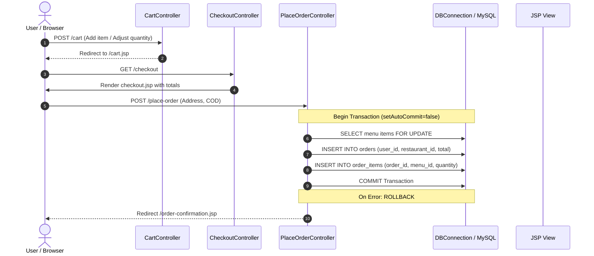
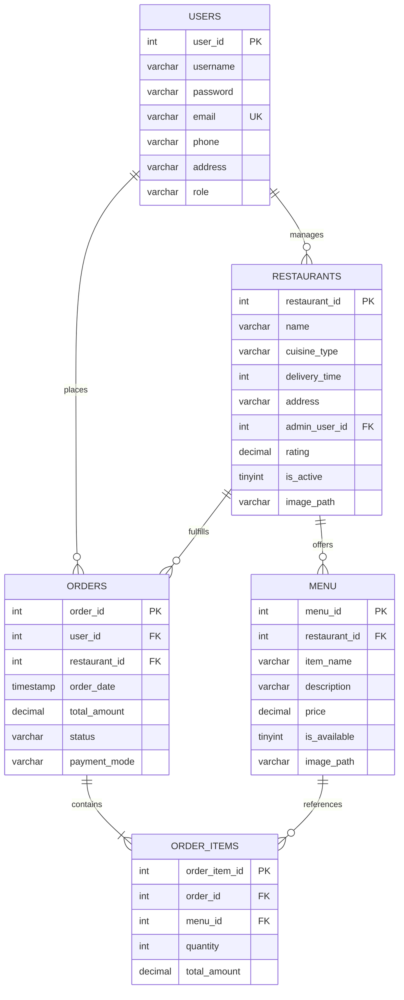

# FoodWala — Online Food Ordering Web Application

[](https://www.oracle.com/java/)
[](https://jakarta.ee/)
[](https://tomcat.apache.org/)
[](https://www.mysql.com/)
[](https://www.docker.com/)
[](https://railway.app/)

> **Live Website:** [https://foodwala.up.railway.app](https://foodwala.up.railway.app)  
> **GitHub Repository:** [https://github.com/prasad2518/FoodWala](https://github.com/prasad2518/FoodWala)

---

## Table of Contents
1. [Project Overview](#project-overview)
2. [Live Demo & Repository](#live-demo--repository)
3. [Project Objectives](#project-objectives)
4. [Key Features](#key-features)
5. [Technology Stack](#technology-stack)
6. [Architecture & Request Flow](#architecture--request-flow)
7. [Project Directory Structure](#project-directory-structure)
8. [Database Schema Overview](#database-schema-overview)
9. [Local Setup & Prerequisites](#local-setup--prerequisites)
10. [Running in Eclipse with Tomcat 10.1](#running-in-eclipse-with-tomcat-101)
11. [Railway Cloud Deployment](#railway-cloud-deployment)
12. [Application Screenshots](#application-screenshots)
13. [Future Enhancements](#future-enhancements)
14. [Author & Contact](#author--contact)

---

## Project Overview

**FoodWala** is a full-stack Java Dynamic Web Application engineered for online food discovery, menu exploration, session-based shopping cart management, and seamless order checkout.

Designed strictly following the **Model-View-Controller (MVC)** architectural pattern and the **Data Access Object (DAO)** structural design pattern, FoodWala avoids heavy, opaque frameworks to showcase fundamental software engineering principles: object-oriented programming (OOP), Jakarta EE Servlets, JavaServer Pages (JSP), JDBC connection lifecycle management, ACID database transactions, and BCrypt-based password security.

The application is containerized with **Docker** on **Apache Tomcat 10.1** and **Eclipse Temurin JDK 17**, and is deployed live on **Railway**.

---

## Live Demo & Repository

- **Live Production URL:** [https://foodwala.up.railway.app](https://foodwala.up.railway.app)
- **Source Code Repository:** [https://github.com/prasad2518/FoodWala](https://github.com/prasad2518/FoodWala)

---

## Project Objectives

1. **Demonstrate Core Java & Jakarta EE Mastery:** Build an enterprise dynamic web application using pure Java Servlets, JSP, and JDBC, emphasizing clean architecture over framework abstraction.
2. **Implement Enterprise MVC & DAO Patterns:** Decouple data transfer models, persistent relational database access, presentation views, and HTTP controller logic.
3. **Ensure ACID-Compliant Transactional Integrity:** Guarantee consistent checkout execution where orders and itemized records are atomically committed or rolled back together.
4. **Deliver Secure User Authentication:** Protect user credentials with server-side validation, password hashing using the industry-standard BCrypt algorithm with salted rounds, and session fixation defense.
5. **Establish Cloud-Native Containerization:** Provide automated cloud deployments using a custom Dockerfile on Railway with dynamic environment variable configuration.

---

## Key Features

### 1. Restaurant Discovery & Dynamic Filtering
- Browse curated restaurants featuring cuisine classifications, ratings, delivery times, and physical locations.
- **Category Filter:** Filter restaurants across 9 cuisine categories (*All, Biryani, North Indian, South Indian, Fast Food, Pizzas, Chinese, Desserts, Beverages*).
- **Keyword Search:** Real-time search query matching restaurant names, cuisine specialties, and dish names.

### 2. Interactive Restaurant Menu
- Dedicated menu view displaying available dishes per restaurant.
- Real-time availability indicator showing currently prepared dishes.
- Direct "Add to Cart" action with instant session updates.

### 3. Session-Managed Shopping Cart
- Built on Java HTTP Session (`HttpSession`) without requiring third-party cookies or client-side storage dependencies.
- Dynamically add menu items, increment or decrement item quantities, or delete items.
- Live subtotal calculation, standardized delivery fee calculation (₹40.00), and grand total summary.

### 4. Secure Authentication & User Registration
- Comprehensive server-side validation ensuring valid email formatting, 10-digit mobile numbers, and password confirmation.
- **BCrypt Hashing:** Passwords encrypted using `jBCrypt` with 12 salt rounds before database persistence.
- **Session Security:** Invokes `request.changeSessionId()` upon successful login to prevent Session Fixation attacks.
- Graceful logout invalidating active sessions and setting HTTP no-cache headers (`Cache-Control: no-cache, no-store, must-revalidate`).

### 5. Transactional Checkout & Order Placement
- Pre-populates verified delivery address and contact information for authenticated users.
- Server-side price verification and row-level locking (`SELECT ... FOR UPDATE`) ensuring cart items cannot be modified during order execution.
- Single-restaurant enforcement ensuring all items in an order originate from the same vendor.
- **Atomic JDBC Transactions:** Inserts parent record into `orders` and child records into `order_items` inside a single `Connection` transaction (`setAutoCommit(false)`, `commit()`, `rollback()`).

### 6. Order Confirmation & Order History
- Instant generation of unique numeric Order IDs.
- Comprehensive order history screen displaying past orders sorted chronologically with status indicators (`PLACED`), timestamps, and itemized dish breakdowns.

### 7. Profile Management
- Displays user profile information, contact number, delivery address, and assigned role (`CUSTOMER`).

---

## Technology Stack

| Layer | Technologies | Description |
|---|---|---|
| **Frontend** | HTML5, CSS3, JavaScript, JSP, JSPF | Semantic HTML, modular CSS styling (`auth.css`, `cart.css`, `restaurant.css`, etc.), reusable JSP Fragments for header/navigation and footer. |
| **Backend** | Java 17, Jakarta EE Servlet API 5.0 (Tomcat 10.1) | Controller servlets (`@WebServlet`), Java Beans (POJOs), DAO design pattern, jBCrypt 0.4 password security. |
| **Database** | MySQL 8.0, JDBC (Java Database Connectivity) | Relational schema, foreign key cascades, prepared statements, atomic transactions, row locking. |
| **Database Driver** | MySQL Connector/J 9.x | High-performance JDBC driver with SSL configuration and public key retrieval support. |
| **Application Server** | Apache Tomcat 10.1 | Jakarta EE-compliant HTTP servlet and JSP web server container. |
| **Containerization** | Docker | Linux container based on `tomcat:10.1-jdk17-temurin` with automated headless compilation. |
| **Hosting & Cloud** | Railway | Cloud platform hosting Tomcat container and private MySQL database service via internal DNS. |
| **Version Control** | Git, GitHub | Distributed version control and automated continuous deployment pipeline. |

---

## Architecture & Request Flow

FoodWala follows a strict **Model-View-Controller (MVC)** tiered design:

```
[ Client Browser ]
       │
       ▼ HTTP (GET / POST)
[ Controller (Jakarta Servlets) ]
  ├── Validates Input & HTTP Session
  ├── Orchestrates Business Flow
  └── Invokes Data Access Layer
       │
       ▼ Java Method Calls
[ Data Access Object (DAO Layer) ]
  ├── PreparedStatement Execution
  ├── Transaction Management (commit / rollback)
  └── Maps ResultSet to Models (POJOs)
       │
       ▼ JDBC Driver (Port 3306)
[ MySQL Database ]
       │
       ▼ Hydrated Java Model Objects
[ Controller forwards Data via Request Attributes ]
       │
       ▼ RequestDispatcher.forward()
[ View (JavaServer Pages - JSP) ]
  ├── Renders dynamic HTML via JSP Expression Language & Scriptlets
  └── Includes reusable UI components (navbar.jspf, footer.jspf)
       │
       ▼ Rendered HTML/CSS/JS Response
[ Client Browser ]
```

### Order Placement Sequence Flow



---

## Project Directory Structure

```text
FoodWala/
├── .gitignore                                 # Git ignore configuration
├── Dockerfile                                 # Containerized production Tomcat build
├── README.md                                  # Comprehensive project documentation
├── src/
│   └── main/
│       ├── java/
│       │   └── com/
│       │       └── tap/
│       │           ├── controlers/            # Controller layer (Jakarta Servlets)
│       │           │   ├── CartController.java
│       │           │   ├── CheckoutController.java
│       │           │   ├── LoginController.java
│       │           │   ├── LogoutController.java
│       │           │   ├── MenuController.java
│       │           │   ├── OrderHistoryController.java
│       │           │   ├── PlaceOrderController.java
│       │           │   ├── RegisterController.java
│       │           │   └── RestaurantController.java
│       │           ├── dao/                   # Data Access Object interfaces
│       │           │   ├── MenuDao.java
│       │           │   ├── OrderDao.java
│       │           │   ├── OrderItemDao.java
│       │           │   ├── RestaurantDao.java
│       │           │   └── UserDao.java
│       │           ├── daoimpl/               # JDBC DAO implementation classes
│       │           │   ├── MenuDaoImpl.java
│       │           │   ├── OrderDaoImpl.java
│       │           │   ├── OrderItemDaoImpl.java
│       │           │   ├── RestaurantDaoImpl.java
│       │           │   └── UserDaoImpl.java
│       │           ├── model/                 # Domain entity POJOs
│       │           │   ├── CartItem.java
│       │           │   ├── Menu.java
│       │           │   ├── Order.java
│       │           │   ├── OrderItem.java
│       │           │   ├── Restaurant.java
│       │           │   └── User.java
│       │           └── util/                  # Utility & connection management
│       │               ├── DBConnection.java
│       │               └── TestDBConnection.java
│       └── webapp/                            # Presentation layer & web assets
│           ├── cart.jsp                       # Shopping cart view
│           ├── checkout.jsp                   # Order checkout view
│           ├── index.jsp                      # Entry point (redirects to /restaurants)
│           ├── login.jsp                      # User authentication view
│           ├── menu.jsp                       # Restaurant menu view
│           ├── order-confirmation.jsp         # Order success receipt view
│           ├── orders.jsp                     # User order history view
│           ├── profile.jsp                    # Account profile view
│           ├── register.jsp                   # Account registration view
│           ├── resturant.jsp                  # Main restaurant exploration view
│           ├── css/                           # Modular stylesheets
│           │   ├── auth.css
│           │   ├── base.css
│           │   ├── cart.css
│           │   ├── checkout.css
│           │   ├── components.css
│           │   ├── menu.css
│           │   ├── profile.css
│           │   └── restaurant.css
│           ├── images/                        # Visual branding & assets
│           │   └── foodwala-logo.png
│           ├── META-INF/
│           │   └── MANIFEST.MF
│           └── WEB-INF/
│               ├── web.xml                    # Servlet deployment descriptor
│               ├── jsp/
│               │   └── common/                # Reusable presentation fragments
│               │       ├── footer.jspf
│               │       └── navbar.jspf
│               └── lib/                       # External runtime libraries
│                   ├── jbcrypt-0.4.jar
│                   └── mysql-connector-j-9.7.0/
```

---

## Database Schema Overview

The relational database is structured into 5 normalized tables with enforced referential integrity and cascading relationships:



### Table Descriptions

1. **`users`**: Stores registered user profiles, contact credentials, addresses, and authorization roles (`CUSTOMER`, `ADMIN`). Passwords are encrypted using BCrypt.
2. **`restaurants`**: Contains catalogued restaurants, cuisine classifications, delivery time estimates, active operational statuses, and ratings.
3. **`menu`**: Stores itemized dishes linked to specific restaurants, unit prices, dish descriptions, image URLs, and live availability toggles.
4. **`orders`**: Tracks completed transactions, assigned customers, servicing restaurants, grand totals, placement timestamps, and payment modes (`COD`).
5. **`order_items`**: Child table maintaining specific quantities and line-item totals for dishes included in each parent order.

---

## Local Setup & Prerequisites

Before setting up the project locally, ensure you have the following installed:

- **Java Development Kit (JDK):** Version 17 or higher
- **Web Application Server:** Apache Tomcat 10.1.x (supports Jakarta EE 9 / 10 / Servlet 5.0+)
- **Database Server:** MySQL Server 8.0 or higher
- **IDE:** Eclipse IDE for Enterprise Java and Web Developers (or IntelliJ IDEA Ultimate)
- **Version Control:** Git

---

## Running in Eclipse with Tomcat 10.1

### Step 1: Clone the Repository
Open your terminal or command prompt and clone the repository:

```bash
git clone https://github.com/prasad2518/FoodWala.git
```

### Step 2: Set Up the MySQL Database

> **Database Backup Note:**  
> The SQL database dump (`Dump20261015.sql`) containing the initial seed data (30 restaurants, 360 menu items, sample users) is **not included in the GitHub repository** to avoid committing large binary/data files and protect sample user records.  
> 
> You can either:
> 1. Obtain the `Dump20261015.sql` backup file separately from the project maintainer and import it.
> 2. Or execute the schema creation script below to initialize the database tables directly.

1. Open MySQL Command Line Client or MySQL Workbench:
   ```sql
   CREATE DATABASE IF NOT EXISTS foodwala CHARACTER SET utf8mb4 COLLATE utf8mb4_0900_ai_ci;
   USE foodwala;
   ```

2. If you have the SQL backup file, import it into the `foodwala` database:
   ```bash
   mysql -u root -p foodwala < path/to/Dump20261015.sql
   ```

3. Alternatively, create the tables manually if setting up without the dump:
   ```sql
   CREATE TABLE users (
     user_id INT AUTO_INCREMENT PRIMARY KEY,
     username VARCHAR(100) NOT NULL,
     password VARCHAR(255) NOT NULL,
     email VARCHAR(255) NOT NULL UNIQUE,
     phone VARCHAR(15) DEFAULT NULL,
     address VARCHAR(500) DEFAULT NULL,
     role VARCHAR(20) DEFAULT 'CUSTOMER'
   );

   CREATE TABLE restaurants (
     restaurant_id INT AUTO_INCREMENT PRIMARY KEY,
     name VARCHAR(100) NOT NULL,
     cuisine_type VARCHAR(100) DEFAULT NULL,
     delivery_time INT DEFAULT NULL,
     address VARCHAR(255) DEFAULT NULL,
     admin_user_id INT DEFAULT NULL,
     rating DECIMAL(2,1) DEFAULT 0.0,
     is_active TINYINT(1) DEFAULT 1,
     image_path VARCHAR(255) DEFAULT NULL,
     CONSTRAINT fk_restaurant_admin FOREIGN KEY (admin_user_id) REFERENCES users (user_id) ON DELETE SET NULL ON UPDATE CASCADE
   );

   CREATE TABLE menu (
     menu_id INT AUTO_INCREMENT PRIMARY KEY,
     restaurant_id INT NOT NULL,
     item_name VARCHAR(100) NOT NULL,
     description VARCHAR(500) DEFAULT NULL,
     price DECIMAL(10,2) NOT NULL,
     is_available TINYINT(1) DEFAULT 1,
     image_path VARCHAR(255) DEFAULT NULL,
     CONSTRAINT fk_menu_restaurant FOREIGN KEY (restaurant_id) REFERENCES restaurants (restaurant_id) ON DELETE CASCADE ON UPDATE CASCADE
   );

   CREATE TABLE orders (
     order_id INT AUTO_INCREMENT PRIMARY KEY,
     user_id INT NOT NULL,
     restaurant_id INT NOT NULL,
     order_date TIMESTAMP NULL DEFAULT CURRENT_TIMESTAMP,
     total_amount DECIMAL(10,2) NOT NULL,
     status VARCHAR(50) DEFAULT 'PENDING',
     payment_mode VARCHAR(50) DEFAULT 'COD',
     CONSTRAINT fk_order_user FOREIGN KEY (user_id) REFERENCES users (user_id) ON DELETE CASCADE ON UPDATE CASCADE,
     CONSTRAINT fk_order_restaurant FOREIGN KEY (restaurant_id) REFERENCES restaurants (restaurant_id) ON DELETE CASCADE ON UPDATE CASCADE
   );

   CREATE TABLE order_items (
     order_item_id INT AUTO_INCREMENT PRIMARY KEY,
     order_id INT NOT NULL,
     menu_id INT NOT NULL,
     quantity INT NOT NULL,
     total_amount DECIMAL(10,2) NOT NULL,
     CONSTRAINT fk_order_items_order FOREIGN KEY (order_id) REFERENCES orders (order_id) ON DELETE CASCADE ON UPDATE CASCADE,
     CONSTRAINT fk_order_items_menu FOREIGN KEY (menu_id) REFERENCES menu (menu_id) ON DELETE CASCADE ON UPDATE CASCADE
   );
   ```

4. Confirm that all 5 tables exist:
   ```sql
   SHOW TABLES;
   ```

### Step 3: Configure Database Credentials
`DBConnection.java` dynamically reads connection details from environment variables.

For local development in Eclipse:
- **Default fallback:** If no environment variables are defined, `DBConnection.java` connects to `jdbc:mysql://localhost:3306/foodwala` with username `root` and an empty password.
- **Custom Credentials:** To supply your local MySQL password securely without modifying source code, configure runtime environment variables in Eclipse:
  1. In Eclipse, right-click the project -> **Run As** -> **Run Configurations...**
  2. Select your Apache Tomcat server instance under **Apache Tomcat**.
  3. Open the **Environment** tab.
  4. Click **New...** and add:
     - `DB_HOST`: `localhost`
     - `DB_PORT`: `3306`
     - `DB_NAME`: `foodwala`
     - `DB_USERNAME`: `root`
     - `DB_PASSWORD`: `<your_local_mysql_password>`
  5. Click **Apply**.

### Step 4: Import Project into Eclipse
1. Open Eclipse -> **File** -> **Import...**
2. Select **General** -> **Existing Projects into Workspace** -> Click **Next**.
3. Set the **Root Directory** to the cloned `FoodWala` folder.
4. Ensure the `FoodWala` project is checked and click **Finish**.

### Step 5: Configure Apache Tomcat 10.1 Runtime
1. In Eclipse, navigate to **Window** -> **Preferences** -> **Server** -> **Runtime Environments**.
2. Click **Add...**, select **Apache Tomcat v10.1**, and click **Next**.
3. Browse to your local Tomcat 10.1 installation directory and select **JDK 17**.
4. Click **Finish**, then **Apply and Close**.
5. Right-click the project in Project Explorer -> **Properties** -> **Targeted Runtimes** -> Ensure **Apache Tomcat v10.1** is checked -> Click **Apply and Close**.

### Step 6: Deploy and Run
1. In the **Servers** view, right-click -> **New** -> **Server**.
2. Select **Apache Tomcat v10.1**, click **Next**, add **FoodWala** to the configured projects, and click **Finish**.
3. Right-click the server -> **Start**.
4. Open your web browser and navigate to:
   ```text
   http://localhost:8080/FoodWala/
   ```
   *(Tomcat will invoke `index.jsp` and automatically redirect to the `/restaurants` controller).*

---

## Railway Cloud Deployment

FoodWala is deployed to the cloud on **Railway** utilizing a containerized architecture:

### Dockerfile Deployment Strategy
The project root contains a streamlined, containerized `Dockerfile`:
```dockerfile
FROM tomcat:10.1-jdk17-temurin

# Remove Tomcat's default web applications
RUN rm -rf /usr/local/tomcat/webapps/ROOT

# Copy project files
COPY . /tmp/foodwala

# Deploy web resources to Tomcat ROOT application
RUN mkdir -p /usr/local/tomcat/webapps/ROOT \
    && cp -r /tmp/foodwala/src/main/webapp/. /usr/local/tomcat/webapps/ROOT/

# Setup class and library directories
RUN mkdir -p /usr/local/tomcat/webapps/ROOT/WEB-INF/classes \
    && mkdir -p /usr/local/tomcat/webapps/ROOT/WEB-INF/lib

# Copy required JAR dependencies
RUN cp /tmp/foodwala/src/main/webapp/WEB-INF/lib/jbcrypt-0.4.jar /usr/local/tomcat/webapps/ROOT/WEB-INF/lib/ \
    && cp /tmp/foodwala/src/main/webapp/WEB-INF/lib/mysql-connector-j-9.7.0/mysql-connector-j-9.7.0.jar /usr/local/tomcat/webapps/ROOT/WEB-INF/lib/

# Compile all Java sources directly into WEB-INF/classes
RUN find /tmp/foodwala/src/main/java -name "*.java" > /tmp/sources.txt \
    && javac -cp "/usr/local/tomcat/lib/*:/usr/local/tomcat/webapps/ROOT/WEB-INF/lib/*" \
    -d /usr/local/tomcat/webapps/ROOT/WEB-INF/classes @/tmp/sources.txt

EXPOSE 8080

CMD ["catalina.sh", "run"]
```

### Railway Environment Configuration
In the Railway Dashboard under the **FoodWala** service settings, the following environment variables are securely configured:

| Variable | Recommended Production Value | Description |
|---|---|---|
| `DB_URL` | `jdbc:mysql://mysql.railway.internal:3306/foodwala?useSSL=false&allowPublicKeyRetrieval=true&serverTimezone=UTC` | Internal Railway private DNS connection string |
| `DB_NAME` | `foodwala` | Dedicated database name |
| `DB_USERNAME` | `<Your Railway MySQL Username>` | Railway MySQL service username |
| `DB_PASSWORD` | `<Your Railway MySQL Password>` | Securely injected database password |

---

## Application Screenshots

> *Note: UI screenshots can be captured directly from the live application at [https://foodwala.up.railway.app](https://foodwala.up.railway.app) and placed in the repository.*

| Page / Feature | View Description | Screenshot Status |
|---|---|---|
| **Restaurants Page** | Hero banner, cuisine category quick-filters, real-time search bar, and restaurant listing cards with ratings and delivery times. | *[Screenshot Placeholder]* |
| **Restaurant Menu** | Itemized dish catalog featuring dish images, availability badges, descriptions, and Add to Cart action buttons. | *[Screenshot Placeholder]* |
| **Shopping Cart** | Live cart screen with item quantity increment/decrement controls, item deletion, subtotal, and ₹40 delivery fee. | *[Screenshot Placeholder]* |
| **Checkout & Delivery** | Customer contact information, pre-filled delivery address, Cash on Delivery (COD) payment selection, and Place Order button. | *[Screenshot Placeholder]* |
| **Order Confirmation** | Order receipt presenting generated Order ID, total amount paid, delivery details, and continue shopping options. | *[Screenshot Placeholder]* |
| **User Order History** | Ledger of all past user orders displaying placement timestamps, status badges (`PLACED`), and food details. | *[Screenshot Placeholder]* |
| **User Authentication** | Clean, responsive Login and Registration forms with server-side validation error displays. | *[Screenshot Placeholder]* |
| **Account Profile** | User account management view displaying registered name, contact number, email, address, and role. | *[Screenshot Placeholder]* |

---

## Future Enhancements

The following features represent proposed roadmap enhancements designed for future iteration:

- [ ] **Online Payment Gateway Integration:** Incorporate Razorpay and Stripe APIs for UPI, credit/debit card, and net-banking transactions.
- [ ] **Real-Time Order Tracking:** Implement WebSockets for live status transitions (*Confirmed -> Preparing -> Out for Delivery -> Delivered*).
- [ ] **Restaurant Admin Portal:** Build a dedicated administrative dashboard for restaurant partners to manage menus, toggle dish availability, and process incoming orders.
- [ ] **Customer Reviews & Ratings:** Allow verified customers to post reviews and star ratings after successful order deliveries.
- [ ] **Automated Notifications:** Email and SMS order confirmation alerts via SendGrid or Twilio.

---

## Author & Contact

**Developed by:** Prasad Yenuganti  
- **GitHub:** [@prasad2518](https://github.com/prasad2518)  
- **Project Repository:** [https://github.com/prasad2518/FoodWala](https://github.com/prasad2518/FoodWala)  
- **Live Deployment:** [https://foodwala.up.railway.app](https://foodwala.up.railway.app)

---

*FoodWala is distributed under open academic and portfolio review. Feel free to explore, clone, and star the repository!*
